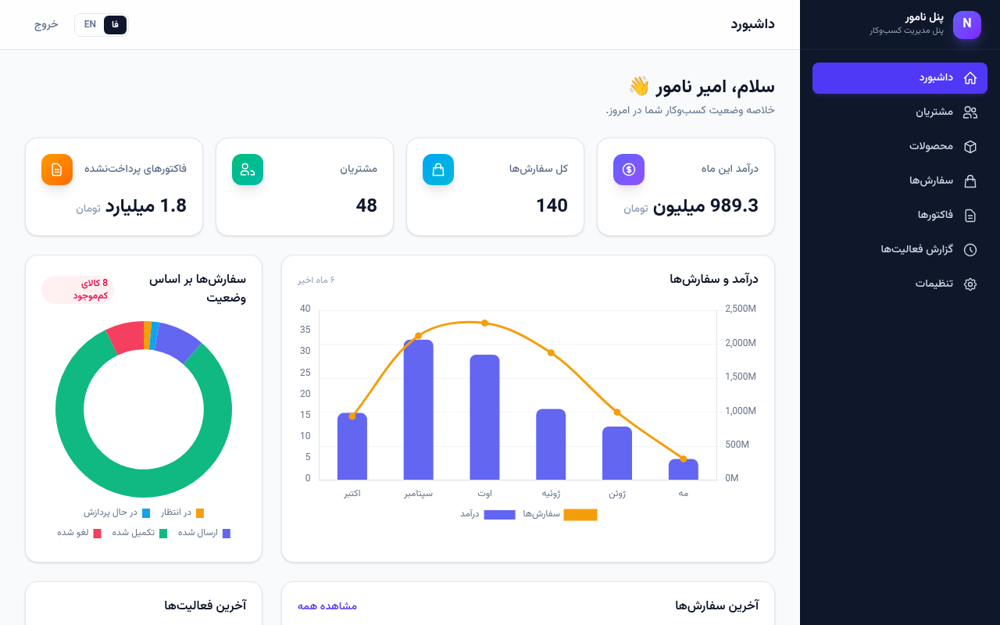
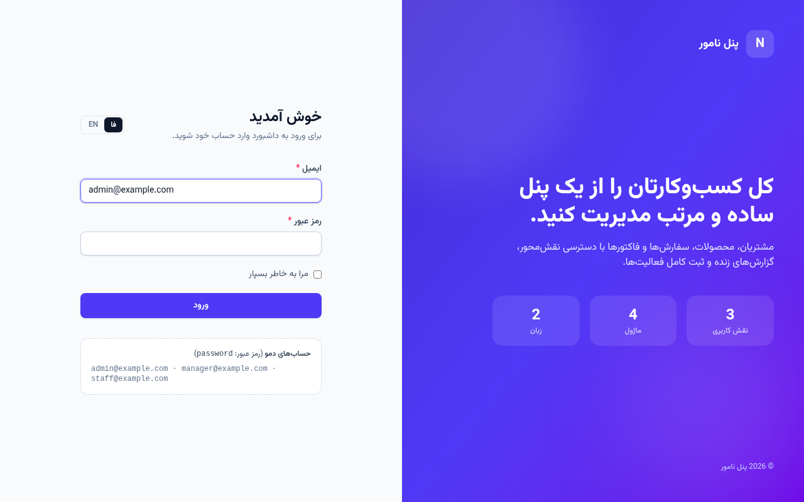
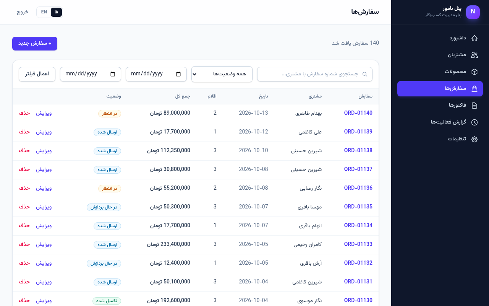
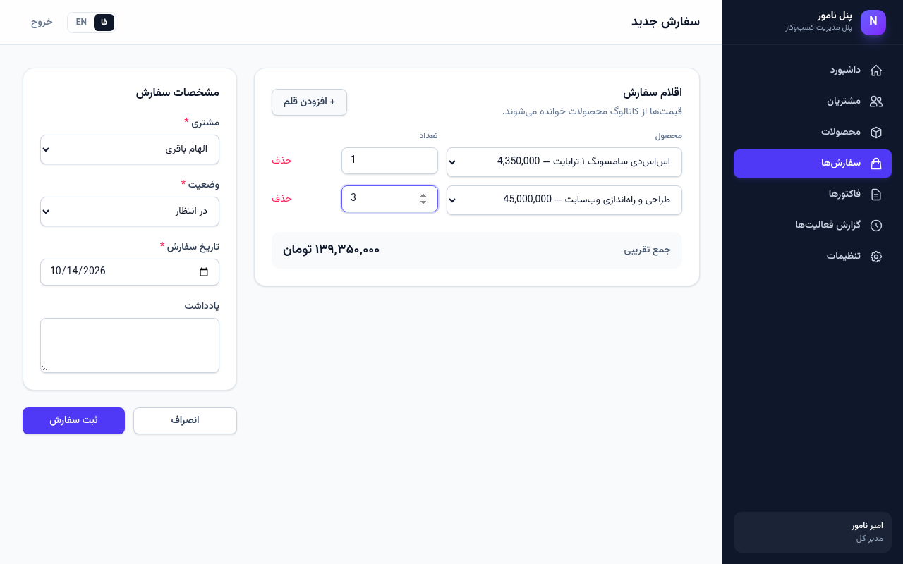

# Namvar Admin — Laravel Business Admin Panel

A clean, bilingual (Persian RTL / English) admin panel for small and medium businesses, built with **Laravel 13** and **Tailwind CSS 4**. It covers the day-to-day back office: customers, products, orders, invoices, reporting, user roles and a full audit trail.

[فارسی ↓](#فارسی)



| Login | Orders | Order form |
|---|---|---|
|  |  |  |

## Features

- **Authentication with roles** — `admin`, `manager`, `staff`, enforced with Gates and middleware (inactive users are blocked, login is rate limited).
- **Dashboard** — summary cards (monthly revenue, orders, customers, outstanding invoices), a 6‑month revenue/orders chart, orders-by-status doughnut, recent orders and latest activity (Chart.js).
- **CRUD modules** — customers, products, orders (with dynamic line items and live total) and invoices, each with search, filters, pagination and server-side validation.
- **Activity log** — every create/update/delete plus logins/logouts is recorded with user, subject and IP, filterable by action and user.
- **Settings** — company info, currency, default tax rate, rows per page, default language (admin only).
- **Persian RTL UI with English toggle** — full `fa`/`en` translations, including validation messages; layout mirrors automatically.
- **Responsive design** — collapsible sidebar on mobile, Vazirmatn font, consistent components.
- **Realistic demo data** — 20 products, 48 customers, 140 orders spread over six months, invoices and activity entries.
- **Feature tests** — auth, roles & permissions, CRUD, validation, filters, order totals and invoicing (23 tests).

## Permissions

| Area | Admin | Manager | Staff |
|---|:-:|:-:|:-:|
| Dashboard, view lists | ✓ | ✓ | ✓ |
| Create / edit customers & orders | ✓ | ✓ | ✓ |
| Create / edit products & invoices | ✓ | ✓ | — |
| Delete records | ✓ | ✓ | — |
| Activity log | ✓ | ✓ | — |
| Settings | ✓ | — | — |

## Tech stack

- PHP 8.3+ · Laravel 13 · Eloquent ORM · SQLite (MySQL/PostgreSQL ready)
- Blade components · Tailwind CSS 4 · Vite · Chart.js
- PHPUnit feature tests

## Getting started

```bash
git clone https://github.com/som-info/laravel-admin-panel.git
cd laravel-admin-panel
composer install
cp .env.example .env
php artisan key:generate
touch database/database.sqlite
php artisan migrate --seed
npm install && npm run build
php artisan serve
```

Open http://localhost:8000 and sign in.

Run the tests:

```bash
php artisan test
```

## Demo credentials

All demo accounts use the password **`password`**.

| Role | Email |
|---|---|
| Admin | `admin@example.com` |
| Manager | `manager@example.com` |
| Staff | `staff@example.com` |

## Project structure

```
app/Http/Controllers   Dashboard, CRUD, activity log, settings, auth
app/Http/Middleware    SetLocale (fa/en), EnsureRole
app/Models             Customer, Product, Order, OrderItem, Invoice, ActivityLog, Setting
app/Models/Concerns    LogsActivity trait (automatic audit trail)
lang/                  fa.json, en.json, fa/validation.php
resources/views        Blade layout, components and module views
tests/Feature          Feature tests for the main flows
```

---

<div dir="rtl">

## فارسی

**پنل نامور** یک پنل مدیریت کسب‌وکار دوزبانه (فارسی راست‌چین / انگلیسی) است که با **لاراول ۱۳** و **Tailwind CSS 4** ساخته شده و کارهای روزمره‌ی بخش اداری را پوشش می‌دهد: مشتریان، محصولات، سفارش‌ها، فاکتورها، گزارش‌گیری، نقش‌های کاربری و ثبت کامل فعالیت‌ها.

### امکانات

- **احراز هویت با نقش‌ها** — مدیر کل، مدیر و کارمند؛ کنترل دسترسی با Gate و Middleware، محدودیت تلاش برای ورود و مسدودسازی کاربران غیرفعال.
- **داشبورد** — کارت‌های خلاصه (درآمد ماه، سفارش‌ها، مشتریان، فاکتورهای پرداخت‌نشده)، نمودار درآمد و سفارش ۶ ماه اخیر، نمودار وضعیت سفارش‌ها، آخرین سفارش‌ها و فعالیت‌ها.
- **مدیریت کامل (CRUD)** — مشتریان، محصولات، سفارش‌ها (با اقلام پویا و محاسبه‌ی زنده‌ی جمع) و فاکتورها با جستجو، فیلتر، صفحه‌بندی و اعتبارسنجی سمت سرور.
- **گزارش فعالیت‌ها** — ثبت خودکار ایجاد، ویرایش، حذف، ورود و خروج کاربران همراه با IP.
- **تنظیمات** — اطلاعات شرکت، واحد پول، نرخ مالیات، تعداد ردیف و زبان پیش‌فرض.
- **رابط کاربری فارسی راست‌چین با امکان تغییر به انگلیسی** — شامل پیام‌های اعتبارسنجی فارسی.
- **طراحی واکنش‌گرا** — منوی کناری جمع‌شونده در موبایل و فونت وزیرمتن.
- **داده‌ی نمایشی واقعی** و **تست‌های Feature** برای جریان‌های اصلی.

### تکنولوژی‌ها

PHP 8.3+، لاراول ۱۳، SQLite، Blade، Tailwind CSS 4، Vite، Chart.js، PHPUnit

### راه‌اندازی

دستورات بخش «Getting started» در بالا را اجرا کنید، سپس آدرس `http://localhost:8000` را باز کنید.

### حساب‌های دمو

رمز عبور همه‌ی حساب‌ها: `password`

- مدیر کل: `admin@example.com`
- مدیر: `manager@example.com`
- کارمند: `staff@example.com`

</div>

---

Developed by **Amir Namvar** — freelance full-stack developer.
